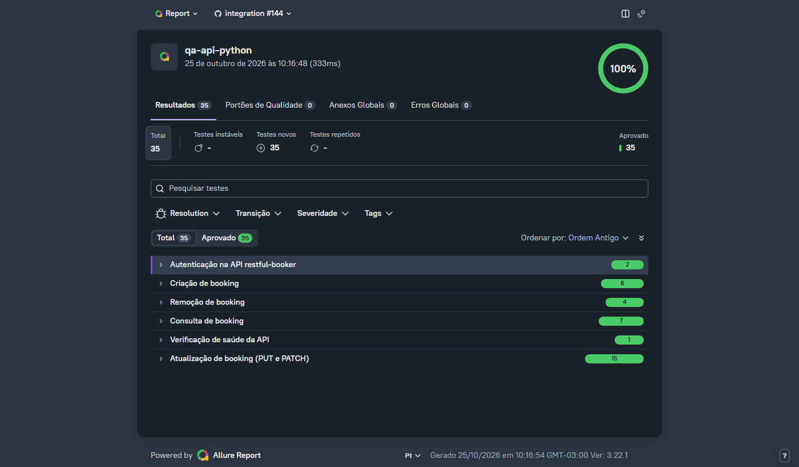

# 🔌 QA API + pytest-bdd - restful-booker

[](https://github.com/ThomasTDS/qa-api-python/actions/workflows/tests.yml)
[](https://codecov.io/gh/ThomasTDS/qa-api-python)
[](https://github.com/ThomasTDS/qa-api-python/actions/workflows/tests.yml)
[](LICENSE)

[Português](README.md) | **English**

## Description

This repository contains automated tests for the public **[restful-booker](https://restful-booker.herokuapp.com)** API, using **requests** (plain HTTP calls, no browser), **pytest-bdd (BDD/Gherkin)** and an **API Clients** layer. For API tests, the clients play the same role the Page Object Model plays in UI tests: they wrap the HTTP calls and keep endpoint and header details out of the steps and scenarios.

The goal is to practice real-world API testing: authentication, full CRUD, the difference between PUT and PATCH, and authorization rules.

The Gherkin scenarios, the test case matrix and the commit history are written in Portuguese, the project's main language.



*Example of a test run report (screenshot). The live, always up-to-date report is at [thomastds.github.io/qa-api-python](https://thomastds.github.io/qa-api-python/).*

---

## Project Structure

```text
qa-api-python/
├── .github/
│   ├── ISSUE_TEMPLATE/
│   │   └── bug_report.md   # Issue template for real bugs
│   ├── workflows/
│   │   ├── tests.yml                  # CI pipeline (push, PR and a scheduled daily run)
│   │   └── dependabot-auto-merge.yml  # Auto-merge for Dependabot patch/minor PRs
│   └── dependabot.yml      # Weekly dependency updates (uv and GitHub Actions)
├── docs/
│   ├── assets/             # Images used in the README
│   └── test-cases.md       # Test case traceability matrix
├── features/                # Gherkin scenarios (.feature)
├── steps/                   # pytest-bdd steps (integration tests, hit the real API)
│   ├── test_<feature>.py    # One module per .feature file, with the steps only it uses
│   ├── common_steps.py      # Steps shared by more than one feature (tokens, created booking, 403, 405)
│   └── booking_data.py      # Default booking and payloads with invalid fields
├── tests/
│   └── unit/                # Isolated unit tests for api/ and models/ (requests-mock, no network) and the test case matrix check
├── api/                     # API Clients (AuthApiClient and BookingApiClient, built on the shared BaseApiClient)
├── models/                  # Pydantic schemas and derived types (shape of the API data)
├── reports/                 # HTML report and coverage (coverage.xml) generated on every run (not versioned)
├── conftest.py              # Fixtures (per-scenario context) and failure evidence capture
├── pyproject.toml           # Dependencies and configuration (pytest, ruff, mypy)
├── uv.lock                  # Exact versions of every dependency (generated by uv)
├── docker-compose.yml       # Local restful-booker with a pinned version, used in CI and to run the tests without the public API
├── .pre-commit-config.yaml  # Pre-commit hooks (ruff, mypy)
├── codecov.yml              # Coverage targets checked by Codecov on PRs
├── LICENSE
├── README.md                # Portuguese version of this README
└── README.en.md             # This file
```

---

### Install Dependencies

The exact versions of every dependency, including transitive ones, are locked in `uv.lock`, generated by [uv](https://docs.astral.sh/uv/). With uv installed (see the [official documentation](https://docs.astral.sh/uv/getting-started/installation/), or `pip install uv`):

```
uv sync --extra dev          # creates .venv and installs exactly what is in uv.lock
.venv\Scripts\activate       # PowerShell / Windows
source .venv/bin/activate    # bash / Linux / macOS

pre-commit install
```

When you change a dependency in `pyproject.toml`, run `uv lock` and commit `uv.lock` along with it. CI installs with `uv sync --locked` and fails if the two files are out of sync.

No browser is needed: these are API tests, so only the `requests` library is used to make the HTTP calls.

### Run all tests

```
pytest
```

At the end of the run, an HTML report is generated at `reports/report.html` (not versioned).

The report for the latest run on `master` is also published at **[thomastds.github.io/qa-api-python](https://thomastds.github.io/qa-api-python/)**, so there is no need to run anything locally or download a CI artifact.

### Run only the smoke suite

```
pytest -m smoke
```

Runs only the most critical end-to-end flows (authentication, creation, retrieval, update and deletion; see [docs/test-cases.md](docs/test-cases.md)). Since `pyproject.toml` always writes to the same file, running this after `pytest` **overwrites** `reports/report.html` with just these 5 scenarios.

### Run only the unit tests

```
pytest tests/unit
```

Isolated tests for `api/` and `models/`, with the HTTP calls mocked through [`requests-mock`](https://requests-mock.readthedocs.io/). They make no network calls, so they run in milliseconds and do not depend on the public API being up. They complement the scenarios in `steps/`, which are real integration tests against `restful-booker`.

### Lint and formatting

```
mypy .                    # typecheck
ruff check .              # lint
ruff format --check .     # formatting, check only
ruff format .             # formatting, apply fixes
pip-audit --skip-editable # checks installed dependencies against known vulnerabilities
```

CI runs `mypy`, `ruff check`, `ruff format --check` and `pip-audit` in the `unit` job, before any test against the API. Changes with type errors, style problems or a vulnerable dependency fail fast, without spending time on calls to the public API. A vulnerability found by `pip-audit` breaks the build, so nothing can be merged without fixing it or assessing that specific case.

Every `pytest` run also measures coverage of `api/` and `models/` (the API Clients and schemas code), printed in the terminal and written to `reports/coverage.xml` (not versioned). In CI, this file is sent to [Codecov](https://codecov.io/gh/ThomasTDS/qa-api-python), which keeps the history and provides the badge at the top of this README.

Codecov also blocks the PR merge (configured in `codecov.yml`) if the new or changed code in the PR (`patch`) is not 100% covered. `codecov.yml` also sets a target for total project coverage (`project`), which may not drop by more than 1 percentage point, but that check is informational only: it is not one of the branch's required checks.

A pre-commit hook (the `pre-commit` framework, installed with `pre-commit install` after `uv sync`) runs `ruff --fix` and `ruff format` on staged files, and `mypy .` on the whole project, before every commit. Most lint, formatting or type problems are caught locally before they reach CI.

### Run against the local API (Docker)

The integration tests can run against a local restful-booker, on the same version used in CI (pinned by the image digest in `docker-compose.yml`). The result then does not depend on the public API being up or on data changed by other people. With Docker running:

```
docker compose up -d                                 # starts the API at http://localhost:3001
$env:BASE_URL="http://localhost:3001"; pytest        # PowerShell
BASE_URL=http://localhost:3001 pytest                # bash
docker compose down                                  # removes the container
```

Data is kept in memory and goes back to its initial state on every `docker compose up`.

### Run against another environment

By default the tests target `https://restful-booker.herokuapp.com` and authenticate with the public credentials from the API documentation (`admin` / `password123`). To run against another environment (for example, a local or staging instance), set these environment variables:

| Variable       | Default                                 | Purpose                              |
| -------------- | --------------------------------------- | ------------------------------------ |
| `BASE_URL`     | `https://restful-booker.herokuapp.com` | API address                          |
| `API_USERNAME` | `admin`                                 | Username used to get the token       |
| `API_PASSWORD` | `password123`                           | Password used to get the token       |

```
# PowerShell
$env:BASE_URL="http://localhost:3001"; $env:API_USERNAME="qa"; $env:API_PASSWORD="qa123"; pytest

# bash
BASE_URL=http://localhost:3001 API_USERNAME=qa API_PASSWORD=qa123 pytest
```

---

### API under test

| Method | Route          | Purpose                                             |
| ------ | -------------- | --------------------------------------------------- |
| POST   | `/auth`        | Creates an authentication token                     |
| GET    | `/booking`     | Lists booking IDs (accepts filters)                 |
| GET    | `/booking/:id` | Gets a specific booking                             |
| POST   | `/booking`     | Creates a booking                                   |
| PUT    | `/booking/:id` | Updates a booking (all fields required)             |
| PATCH  | `/booking/:id` | Partially updates a booking                         |
| DELETE | `/booking/:id` | Deletes a booking                                   |

Authentication: `POST /auth` with `{ "username": "admin", "password": "password123" }` (public credentials from the API documentation, configurable through `API_USERNAME` and `API_PASSWORD`) returns a token, sent on `PUT`, `PATCH` and `DELETE` calls as the cookie `token=<value>`.

**Security note:** `POST /booking` (creation) **does not require authentication**: anyone can create bookings without a token. This is an access control flaw in the demo app itself, and it is covered explicitly in [features/create_booking.feature](features/create_booking.feature) as documented behavior, not as a test bug.

---

### Test Structure and Applied Patterns

- BDD / Gherkin: clear, readable scenarios in `.feature` files, written in Portuguese (`# language: pt`, with `Funcionalidade`, `Cenário`, `Dado`, `Quando` and `Então`, the Portuguese for Feature, Scenario, Given, When and Then) and run with `pytest-bdd`.
- API Client Objects: `AuthApiClient` and `BookingApiClient` wrap the HTTP calls, the same way Page Objects wrap UI elements.
- Timeout on every HTTP call: both clients inherit from `BaseApiClient`, which applies a 5-second limit to connect and 30 seconds to receive the response. Without it, `requests` can wait forever, and a hung API would leave CI stuck until the GitHub Actions run time limit.
- Test pyramid: besides the BDD scenarios (`steps/`), which are real integration tests against `restful-booker`, `tests/unit/` covers `api/` and `models/` in isolation, with `requests-mock` simulating the HTTP responses: no network, no dependency on the public API being up.
- Schema validation with [Pydantic](https://docs.pydantic.dev/): API responses are validated at runtime against the models in `models/booking.py` (single source of truth), not just typed through annotations. If the API changes the shape of a response, the test fails with a clear message instead of passing silently or breaking further along. The models use Pydantic's strict mode, which does not convert types on its own: a `totalprice` sent as text (`"150"`), a `depositpaid` as `"true"` or a date outside the `YYYY-MM-DD` format fails validation. Extra fields in the response are ignored, because the API belongs to a third party and an extra field is not a defect.
- Coverage of authentication, full CRUD, PUT vs. PATCH, and unauthorized access cases (403).
- Automated HTML report on every run (`reports/report.html`, through `pytest-html`), with the `master` version published at [thomastds.github.io/qa-api-python](https://thomastds.github.io/qa-api-python/) through GitHub Pages.
- Code coverage (`pytest-cov`) of `api/` and `models/` on every run, tracked on [Codecov](https://codecov.io/gh/ThomasTDS/qa-api-python).
- Automatic cleanup: the `context` fixture deletes the booking created in the scenario (with its own cleanup token) at the end of each test, so data does not pile up on the public API. If the deletion fails because of a network or authentication error, pytest shows a warning with the id of the booking left behind, without changing the test result.
- Unique test data: each created booking gets a random suffix in its last name (e.g. `Ciclano-3f9a1c`). Since the public API is shared, including by the parallel CI runs, searching by name finds only the test's own booking.
- Automatic retry for network failures only (`pytest-rerunfailures`, with `--reruns 1` and `only_rerun` in `pyproject.toml`): a test that fails because of a connection error or timeout runs a second time, absorbing the instability of the public demo API. Assertion or schema failures are never retried, so an intermittent bug cannot pass on the second attempt.
- Continuous integration with GitHub Actions, in two jobs: `unit` runs the static checks and the unit tests, with no network, and `integration` starts only if `unit` passes, running the full suite against a local restful-booker, in a container with the version pinned in `docker-compose.yml`. A failure in `integration` with `unit` green therefore points to the API or a scenario, not to the clients' code. Both run on every push and pull request to `master`, on Python 3.12 and 3.13, and also daily at 06:00 UTC (see [.github/workflows/tests.yml](.github/workflows/tests.yml)). The daily run targets the public API, to catch changes in its behavior, with the HTML report published as a workflow artifact.
- Dependencies updated automatically by Dependabot (uv, GitHub Actions and the local API's Docker image, weekly; see [.github/dependabot.yml](.github/dependabot.yml)). Patch and minor updates arrive grouped, one PR per week for each ecosystem, and are merged automatically when CI passes ([.github/workflows/dependabot-auto-merge.yml](.github/workflows/dependabot-auto-merge.yml)); major bumps require manual review.
- Audit of known vulnerabilities in the installed dependencies on every CI run, with [`pip-audit`](https://github.com/pypa/pip-audit); finding a vulnerability breaks the build.
- QA traceability: test case matrix in [docs/test-cases.md](docs/test-cases.md), with `@TC-XXX` tags on every `Cenário` (scenario) and a `@smoke` subset (`pytest -m smoke`) covering the most critical end-to-end flows. The `TC-XXX` markers are registered automatically from the `.feature` tags, pytest runs with `--strict-markers` (a misspelled tag breaks collection), and the test [tests/unit/test_traceability.py](tests/unit/test_traceability.py) ensures the matrix lists exactly the TCs in the `.feature` files, with links to the right line of each scenario. Real bugs found are documented as GitHub Issues using the template in [.github/ISSUE_TEMPLATE/bug_report.md](.github/ISSUE_TEMPLATE/bug_report.md).

---

### Workflow

The `master` branch is protected: every change goes through a Pull Request, and merging is only allowed after the CI checks (`unit (3.12)`, `unit (3.13)`, `integration (3.12)` and `integration (3.13)`) and the Codecov new-code coverage check (`codecov/patch`) pass. Standard flow:

```
git checkout -b <branch>
# edit, run pytest locally
git push -u origin <branch>
# open a PR on GitHub, wait for the checks to pass, merge
```
