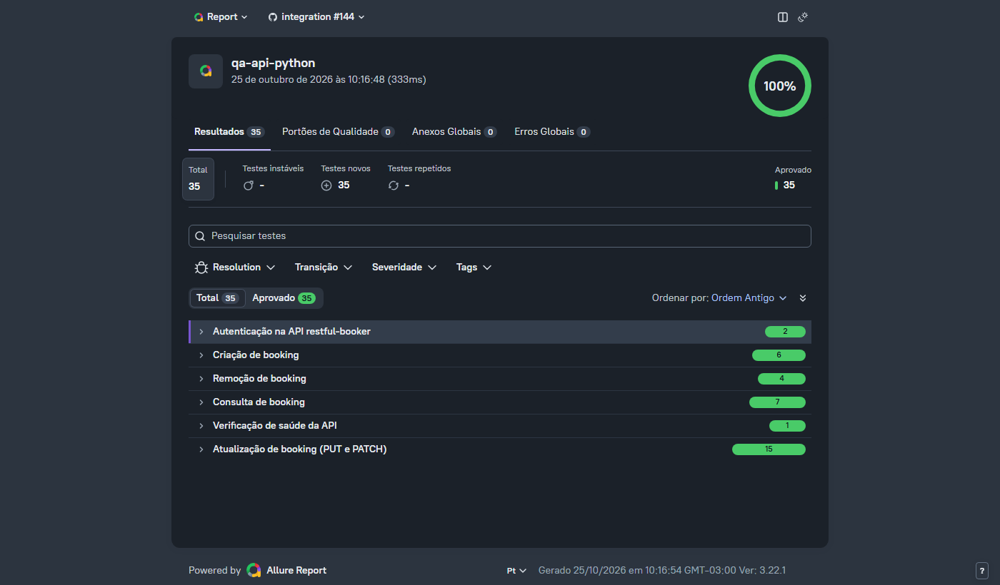

# 🔌 QA API + pytest-bdd - restful-booker

[](https://github.com/ThomasTDS/qa-api-python/actions/workflows/tests.yml)
[](https://codecov.io/gh/ThomasTDS/qa-api-python)
[](https://github.com/ThomasTDS/qa-api-python/actions/workflows/tests.yml)
[](LICENSE)

[Português](README.md) | [English](README.en.md) | **Español**

## Descripción

Este repositorio contiene pruebas automatizadas de la API pública **[restful-booker](https://restful-booker.herokuapp.com)** con **requests** (llamadas HTTP puras, sin navegador), **pytest-bdd (BDD/Gherkin)** y una capa de **API Clients**. En las pruebas de API, los clients cumplen el mismo papel que el Page Object Model en las pruebas de UI: encapsulan las llamadas HTTP y mantienen los detalles de endpoints y headers fuera de los steps y de los escenarios.

El objetivo es practicar pruebas de API "de verdad": autenticación, CRUD completo, la diferencia entre PUT y PATCH, y reglas de autorización.

Qué se prueba, cómo y por qué (alcance, enfoque por nivel, entornos, riesgos y criterios de salida) está descrito en la [estrategia de pruebas](docs/test-strategy.en.md), disponible en inglés y en portugués.

Los escenarios Gherkin, la matriz de casos de prueba y el historial de commits están escritos en portugués, el idioma principal del proyecto.



*Ejemplo del reporte de ejecución (captura de pantalla). El reporte en vivo y siempre actualizado está en [thomastds.github.io/qa-api-python](https://thomastds.github.io/qa-api-python/).*

---

## Estructura del Proyecto

```text
qa-api-python/
├── .github/
│   ├── ISSUE_TEMPLATE/
│   │   └── bug_report.md   # Plantilla de Issue para bugs reales
│   ├── workflows/
│   │   ├── tests.yml                  # Pipeline de CI (push, PR y una ejecución diaria programada)
│   │   ├── mutation.yml               # Pruebas de mutación (semanal y manual)
│   │   └── dependabot-auto-merge.yml  # Auto-merge de los PRs de patch/minor de Dependabot
│   └── dependabot.yml      # Actualización semanal de dependencias (uv y GitHub Actions)
├── docs/
│   ├── assets/             # Imágenes usadas en el README
│   ├── test-cases.md       # Matriz de trazabilidad de los casos de prueba
│   ├── test-strategy.md    # Estrategia de pruebas en portugués
│   └── test-strategy.en.md # Estrategia de pruebas en inglés: alcance, enfoque, entornos, riesgos y criterios
├── features/                # Escenarios en Gherkin (.feature)
├── steps/                   # Steps de pytest-bdd (pruebas de integración, llaman a la API real)
│   ├── test_<feature>.py    # Un módulo por archivo .feature, con los steps que solo él usa
│   ├── common_steps.py      # Steps compartidos por más de una feature (tokens, booking creado, 403, 405)
│   └── booking_data.py      # Booking por defecto y payloads con campos inválidos
├── tests/
│   └── unit/                # Pruebas unitarias aisladas de api/ y models/ (requests-mock, sin red), pruebas basadas en propiedades (Hypothesis) y verificación de la documentación
├── api/                     # API Clients (AuthApiClient y BookingApiClient, sobre la base común BaseApiClient)
├── models/                  # Schemas de Pydantic y tipos derivados (forma de los datos de la API)
├── reports/                 # Resultados y reporte de Allure, y cobertura (coverage.xml), generados en cada ejecución (no versionado)
├── conftest.py              # Fixtures (contexto por escenario) y captura de evidencia de fallos
├── pyproject.toml           # Dependencias y configuración (pytest, ruff, mypy)
├── uv.lock                  # Versiones exactas de todas las dependencias (generado por uv)
├── package.json             # Única dependencia de Node: Allure 3, que genera el reporte
├── package-lock.json        # Versión exacta de Allure 3 y de sus dependencias
├── allurerc.mjs             # Configuración del reporte de Allure (archivo único, historial, agrupación)
├── docker-compose.yml       # restful-booker local, con la versión fijada, usada en el CI y para correr las pruebas sin la API pública
├── .pre-commit-config.yaml  # Hooks de pre-commit (ruff, mypy)
├── codecov.yml              # Metas de cobertura verificadas por Codecov en los PRs
├── LICENSE
├── README.md                # Versión en portugués de este README
├── README.en.md             # Versión en inglés de este README
└── README.es.md             # Este archivo
```

---

### Instalar Dependencias

Las versiones exactas de todas las dependencias, incluidas las transitivas, quedan fijadas en `uv.lock`, generado por [uv](https://docs.astral.sh/uv/). Con uv instalado (ver la [documentación oficial](https://docs.astral.sh/uv/getting-started/installation/), o `pip install uv`):

```
uv sync --extra dev          # crea el .venv e instala exactamente lo que está en uv.lock
.venv\Scripts\activate       # PowerShell / Windows
source .venv/bin/activate    # bash / Linux / macOS

pre-commit install
```

Al cambiar una dependencia en `pyproject.toml`, ejecuta `uv lock` y versiona `uv.lock` junto con el cambio. El CI instala con `uv sync --locked` y falla si los dos archivos no están sincronizados.

Para generar el reporte de Allure también se necesita [Node.js](https://nodejs.org/) (el CI usa la versión 24). Allure 3 es la única dependencia de Node del proyecto.

No hace falta instalar ningún navegador: como son pruebas de API, solo se usa la biblioteca `requests` para hacer las llamadas HTTP.

### Ejecutar todas las pruebas

```
pytest
```

Cada ejecución guarda los resultados en `reports/allure-results` (no versionado). Para ver el reporte de Allure:

```
npm ci            # una vez: instala Allure 3, en la versión de package-lock.json
npm run report    # genera reports/allure-report/index.html a partir de la última ejecución
```

El reporte muestra los escenarios BDD, agrupados por funcionalidad y con los pasos `Dado`, `Quando` y `Então` (Dado, Cuando, Entonces). Las pruebas unitarias aparecen solo en la terminal, porque el plugin de Allure para pytest-bdd registra únicamente los escenarios.

El reporte de la ejecución más reciente en `master` también está publicado en **[thomastds.github.io/qa-api-python](https://thomastds.github.io/qa-api-python/)**, sin necesidad de correr nada localmente ni de descargar un artifact del CI.

Contra la API pública, las pruebas pueden correr en paralelo, en 4 procesos (con [pytest-xdist](https://pytest-xdist.readthedocs.io/)), lo que reduce la ejecución de unos 1 min 47 s a 32 s:

```
pytest -n 4
```

El número fijo de 4, en lugar de un proceso por núcleo, limita cuántas peticiones llegan al mismo tiempo a la API pública, que es compartida. La ejecución diaria del CI corre así. Contra la API local la ganancia es pequeña, porque los escenarios tardan menos de 1 segundo; la mayor parte del tiempo se va en las pruebas basadas en propiedades.

### Ejecutar solo la smoke suite

```
pytest -m smoke
```

Ejecuta solo los flujos de punta a punta más críticos (autenticación, creación, consulta, actualización y eliminación; ver [docs/test-cases.md](docs/test-cases.md)). Como cada ejecución de `pytest` limpia `reports/allure-results`, generar el reporte después de esto muestra **solo estos 5 escenarios**.

### Ejecutar solo las pruebas de seguridad

```
pytest -m seguranca
```

Ejecuta los 7 escenarios de [features/security.feature](features/security.feature), basados en el OWASP API Security Top 10: inyección NoSQL, cabeceras de seguridad, detalles internos en los errores, asignación masiva y validez de los tokens. Son pruebas ligeras, con pocas peticiones cada una, para no perjudicar a la API pública. Tres de ellas registran fallos reales de la API, y las otras cuatro garantizan que las protecciones que funcionan hoy sigan funcionando.

### Ejecutar solo las pruebas unitarias

```
pytest tests/unit
```

Pruebas aisladas de `api/` y `models/`, con las llamadas HTTP simuladas mediante [`requests-mock`](https://requests-mock.readthedocs.io/). No hacen ninguna llamada de red, así que corren en milisegundos y no dependen de que la API pública esté en línea. Complementan los escenarios de `steps/`, que son pruebas de integración reales contra `restful-booker`.

### Ejecutar las pruebas de mutación

[mutmut](https://github.com/boxed/mutmut) modifica a propósito el código de `api/` y `models/` (cambia un `>` por `>=`, quita un argumento, cambia un texto) y ejecuta las pruebas unitarias contra cada versión modificada. Un cambio que ninguna prueba detecta es un "mutante sobreviviente": un comportamiento que la cobertura del 100% no garantiza que esté probado. Corre en el CI ([.github/workflows/mutation.yml](.github/workflows/mutation.yml)) todos los lunes y mediante el disparo manual en la pestaña Actions, con la puntuación y el diff de cada sobreviviente en el resumen de la ejecución. Localmente, solo corre en Linux, macOS o WSL, porque depende de `fork`:

```
uv sync --extra dev --extra mutation
uv run mutmut run
uv run mutmut results
```

La puntuación actual es del 93% (200 de 215 mutantes eliminados). Los 15 sobrevivientes son equivalentes, es decir, no cambian el comportamiento: 13 pasan el método HTTP a minúsculas (`requests` lo convierte a mayúsculas) y 2 cambian las mayúsculas de la cabecera `Content-Type`. Esas líneas ya están marcadas con `# pragma: no mutate`, pero la versión 3.8.0 de mutmut ignora el pragma dentro de instrucciones de varias líneas ([corrección ya aceptada en el proyecto](https://github.com/boxed/mutmut/pull/614), aún sin versión publicada). Cuando salga la próxima versión, Dependabot la traerá, y los equivalentes desaparecerán del conteo.

### Lint y formato

```
mypy .                    # typecheck
ruff check .              # lint
ruff format --check .     # formato, solo verifica
ruff format .             # formato, aplica las correcciones
pip-audit --skip-editable # revisa las dependencias instaladas contra vulnerabilidades conocidas
```

El CI ejecuta `mypy`, `ruff check`, `ruff format --check` y `pip-audit` en el job `unit`, antes de cualquier prueba contra la API. Los cambios con errores de tipos, problemas de estilo o una dependencia vulnerable fallan rápido, sin gastar tiempo llamando a la API pública. Una vulnerabilidad encontrada por `pip-audit` rompe el build, así que no se puede hacer merge sin resolverla o evaluar ese caso puntual.

Cada ejecución de `pytest` también mide la cobertura de `api/` y `models/` (el código de los API Clients y de los schemas), que se imprime en la terminal y se guarda en `reports/coverage.xml` (no versionado). En el CI, este archivo se envía a [Codecov](https://codecov.io/gh/ThomasTDS/qa-api-python), que mantiene el historial y provee el badge en la parte superior de este README.

Codecov también bloquea el merge del PR (configurado en `codecov.yml`) si el código nuevo o modificado en el PR (`patch`) no tiene el 100% de cobertura. `codecov.yml` también define una meta para la cobertura total del proyecto (`project`), que no puede bajar más de 1 punto porcentual, pero ese check es solo informativo: no forma parte de los checks obligatorios de la rama.

Un hook de pre-commit (el framework `pre-commit`, instalado con `pre-commit install` después de `uv sync`) ejecuta `ruff --fix` y `ruff format` sobre los archivos en staged, y también `mypy .` sobre todo el proyecto, antes de cada commit. Así, la mayoría de los problemas de lint, formato o tipos se detectan localmente antes de llegar al CI.

### Ejecutar contra la API local (Docker)

Las pruebas de integración pueden correr contra una restful-booker local, en la misma versión usada en el CI (fijada por el digest de la imagen en `docker-compose.yml`). Así el resultado no depende de que la API pública esté en línea ni de datos modificados por otras personas. Con Docker en ejecución:

```
docker compose up -d                                 # levanta la API en http://localhost:3001
$env:BASE_URL="http://localhost:3001"; pytest        # PowerShell
BASE_URL=http://localhost:3001 pytest                # bash
docker compose down                                  # elimina el contenedor
```

Los datos se guardan en memoria y vuelven al estado inicial en cada `docker compose up`.

### Ejecutar contra otro entorno

Por defecto las pruebas apuntan a `https://restful-booker.herokuapp.com` y se autentican con las credenciales públicas de la documentación de la API (`admin` / `password123`). Para correr contra otro entorno (por ejemplo, una instancia local o de staging), define estas variables de entorno:

| Variable                 | Valor por defecto                      | Uso                                                                                    |
| ------------------------ | -------------------------------------- | -------------------------------------------------------------------------------------- |
| `BASE_URL`               | `https://restful-booker.herokuapp.com` | Dirección de la API                                                                    |
| `API_USERNAME`           | `admin`                                | Usuario usado para obtener el token                                                    |
| `API_PASSWORD`           | `password123`                          | Contraseña usada para obtener el token                                                 |
| `RESPONSE_TIME_LIMIT_MS` | `3000`                                 | Tiempo máximo de cada respuesta, en milisegundos (el CI usa 500 contra la API local)   |

```
# PowerShell
$env:BASE_URL="http://localhost:3001"; $env:API_USERNAME="qa"; $env:API_PASSWORD="qa123"; pytest

# bash
BASE_URL=http://localhost:3001 API_USERNAME=qa API_PASSWORD=qa123 pytest
```

---

### API probada

| Método | Ruta           | Función                                                                                |
| ------ | -------------- | -------------------------------------------------------------------------------------- |
| GET    | `/ping`        | Health check (responde 201 cuando la API está en línea)                                |
| POST   | `/auth`        | Genera un token de autenticación                                                       |
| GET    | `/booking`     | Lista los IDs de bookings (filtros por nombre y por fechas de checkin y checkout)      |
| GET    | `/booking/:id` | Obtiene un booking específico                                                          |
| POST   | `/booking`     | Crea un booking                                                                        |
| PUT    | `/booking/:id` | Actualiza un booking (todos los campos obligatorios)                                   |
| PATCH  | `/booking/:id` | Actualiza parcialmente un booking                                                      |
| DELETE | `/booking/:id` | Elimina un booking                                                                     |

Autenticación: `POST /auth` con `{ "username": "admin", "password": "password123" }` (credenciales públicas de la documentación de la API, configurables con `API_USERNAME` y `API_PASSWORD`) devuelve un token, que se envía en las llamadas `PUT`, `PATCH` y `DELETE` en la cookie `token=<valor>`. Estas llamadas también aceptan las mismas credenciales por Basic auth (la cabecera `Authorization`), y las dos formas están probadas.

**Nota de seguridad:** `POST /booking` (creación) **no exige autenticación**: cualquiera puede crear bookings sin token. Es un fallo de control de acceso de la propia aplicación de demostración, y está cubierto explícitamente en [features/create_booking.feature](features/create_booking.feature) como comportamiento documentado, no como un bug de la prueba.

---

### Estructura de Pruebas y Patrones Aplicados

- BDD / Gherkin: escenarios claros y legibles en archivos `.feature`, escritos en portugués (`# language: pt`, con `Funcionalidade`, `Cenário`, `Dado`, `Quando` y `Então`, en español Funcionalidad, Escenario, Dado, Cuando y Entonces) y ejecutados con `pytest-bdd`.
- API Client Objects: `AuthApiClient` y `BookingApiClient` encapsulan las llamadas HTTP, de la misma forma que los Page Objects encapsulan los elementos de UI.
- Timeout en todas las llamadas HTTP: los dos clients heredan de `BaseApiClient`, que aplica un límite de 5 segundos para conectar y 30 para recibir la respuesta. Sin esto, `requests` puede esperar indefinidamente, y una API colgada dejaría el CI detenido hasta el tiempo límite de ejecución de GitHub Actions.
- Pruebas basadas en propiedades con [Hypothesis](https://hypothesis.readthedocs.io/) ([tests/unit/test_properties.py](tests/unit/test_properties.py)): en lugar de algunos ejemplos escritos a mano, Hypothesis genera cientos de entradas y busca una que rompa una regla, como "cualquier booking válido sobrevive a la ida y vuelta por JSON" o "la búsqueda envía exactamente los filtros indicados". Son 100 ejemplos por prueba localmente y 1000 en el CI. Las pruebas encontraron dos huecos en el modo estricto de los modelos, ya corregidos: `totalprice` aceptaba `NaN` e infinito, que se convertían en `null` en el JSON enviado a la API, y una fecha aceptaba el texto `"0"`, interpretado como 01/01/1970.
- Pruebas de mutación con [mutmut](https://github.com/boxed/mutmut), semanales: miden si las pruebas unitarias detectan cambios en el código, y no solo si pasan por él. La primera medición (84,7%) reveló 18 huecos reales a pesar de la cobertura del 100%, como mocks que no distinguían `/booking` de `/BOOKING` y un timeout que el client de autenticación podría dejar de pasar. Las pruebas se reforzaron, y la puntuación está en 93%, con todos los sobrevivientes restantes equivalentes.
- Pirámide de pruebas: además de los escenarios BDD (`steps/`), que son pruebas de integración reales contra `restful-booker`, `tests/unit/` cubre `api/` y `models/` de forma aislada, con `requests-mock` simulando las respuestas HTTP: sin red y sin depender de que la API pública esté en línea.
- Validación de schema con [Pydantic](https://docs.pydantic.dev/): las respuestas de la API se validan en tiempo de ejecución contra los modelos de `models/booking.py` (única fuente de verdad), no solo se tipan con anotaciones. Si la API cambia el formato de una respuesta, la prueba falla con un mensaje claro en lugar de pasar en silencio o romperse más adelante. Los modelos usan el modo estricto de Pydantic, que no convierte tipos por su cuenta: un `totalprice` enviado como texto (`"150"`), un `depositpaid` como `"true"` o una fecha fuera del formato `AAAA-MM-DD` no pasan la validación. Los campos extra en la respuesta se ignoran, porque la API es de terceros y un campo de más no es un defecto.
- Cobertura del health check, autenticación (token y Basic auth), CRUD completo, filtros por nombre y por fecha, PUT vs. PATCH, casos de acceso no autorizado (403) y seguridad (inyección NoSQL, cabeceras, errores, asignación masiva y tokens).
- Reporte de [Allure](https://allurereport.org/) en cada ejecución: los escenarios aparecen agrupados por funcionalidad, con los pasos `Dado`, `Quando` y `Então`, y un paso que falla trae adjunta la última respuesta de la API (URL, status, headers y cuerpo). La versión de `master` está publicada en [thomastds.github.io/qa-api-python](https://thomastds.github.io/qa-api-python/), con el historial entre ejecuciones, que muestra tendencias y pruebas inestables. Las pruebas unitarias no entran en el reporte de Allure: sus resultados quedan en la terminal y en el log del CI, y la cobertura en Codecov.
- Cobertura de código (`pytest-cov`) de `api/` y `models/` en cada ejecución, seguida en [Codecov](https://codecov.io/gh/ThomasTDS/qa-api-python).
- Verificación de salud antes de la integración: una fixture de sesión llama a `GET /ping` una vez, antes del primer escenario. Con la API caída, cada prueba de integración aparece como error con el mensaje "API indisponível em <url>" ("API no disponible en <url>") y el motivo, en segundos, en lugar de decenas de fallos de conexión que tardarían minutos y parecerían bugs. Las pruebas unitarias corren normalmente.
- Limpieza automática: la fixture `context` elimina el booking creado en el escenario (con su propio token de limpieza) al final de cada prueba, para que los datos no se acumulen en la API pública. Si la eliminación falla por un error de red o de autenticación, pytest muestra una advertencia con el id del booking que quedó pendiente, sin cambiar el resultado de la prueba.
- Ejecución en paralelo (`pytest-xdist`): la ejecución diaria contra la API pública usa 4 procesos, activados con la variable `PYTEST_ADDOPTS` solo en ese caso, lo que reduce el tiempo unas 3 veces. Correr en paralelo también demuestra que ningún escenario depende de otro. El paralelismo queda fuera del `addopts` del proyecto, porque las pruebas de mutación no funcionan con él.
- Datos de prueba únicos: cada booking creado lleva un sufijo aleatorio en el apellido (p. ej. `Ciclano-3f9a1c`). Como la API pública es compartida, incluso por las ejecuciones paralelas del CI, la búsqueda por nombre encuentra solo el booking de la propia prueba.
- Límite de tiempo de respuesta: un hook en la sesión de `requests` mide cada respuesta de los escenarios, y el escenario falla si alguna supera el límite, con la ruta y el tiempo en el mensaje (por ejemplo, "POST /booking levou 3214 ms", en español "tardó 3214 ms"). El límite es de 500 ms contra la API local, donde cada respuesta tarda pocos milisegundos, y de 3 s contra la pública, el doble del peor tiempo medido en ella (cerca de 1,4 s). No es una prueba de carga: aprovecha las peticiones que los escenarios ya hacen.
- Reintento automático solo para fallos de red (`pytest-rerunfailures`, con `--reruns 1` y `only_rerun` en `pyproject.toml`): una prueba que falla por un error de conexión o un timeout corre una segunda vez, amortiguando la inestabilidad de la API pública de demostración. Los fallos de aserción o de schema nunca se repiten, para que un bug intermitente no pase en el segundo intento.
- Integración continua con GitHub Actions, en dos jobs: `unit` ejecuta las verificaciones estáticas y las pruebas unitarias, sin red, e `integration` solo empieza si `unit` pasa, ejecutando la suite completa contra una restful-booker local, en un contenedor con la versión fijada en `docker-compose.yml`. Así, un fallo en `integration` con `unit` en verde apunta a la API o a un escenario, y no al código de los clients. Los dos corren en cada push y pull request a `master`, en Python 3.12 y 3.13, y también a diario a las 06:00 UTC (ver [.github/workflows/tests.yml](.github/workflows/tests.yml)). La ejecución diaria apunta a la API pública, para detectar cuándo cambia su comportamiento, con el reporte de Allure publicado como artifact del workflow. Si falla, se abre automáticamente una issue con la etiqueta `execucao-diaria` (o recibe un comentario, si ya está abierta), que se cierra sola cuando la ejecución vuelve a pasar. La misma verificación se puede disparar manualmente desde la pestaña Actions.
- Dependencias actualizadas automáticamente por Dependabot (uv, GitHub Actions y la imagen Docker de la API local, semanal; ver [.github/dependabot.yml](.github/dependabot.yml)). Las actualizaciones de patch y minor llegan agrupadas, un PR por semana para cada ecosistema, y se mergean automáticamente cuando el CI pasa ([.github/workflows/dependabot-auto-merge.yml](.github/workflows/dependabot-auto-merge.yml)); los bumps de major requieren revisión manual.
- Auditoría de vulnerabilidades conocidas en las dependencias instaladas en cada ejecución del CI, con [`pip-audit`](https://github.com/pypa/pip-audit); encontrar una vulnerabilidad rompe el build.
- Trazabilidad de QA: matriz de casos de prueba en [docs/test-cases.md](docs/test-cases.md), con tags `@TC-XXX` en cada `Cenário` (escenario) y un subconjunto `@smoke` (`pytest -m smoke`) que cubre los flujos de punta a punta más críticos. Los marcadores `TC-XXX` se registran automáticamente a partir de los tags de los `.feature`, pytest corre con `--strict-markers` (un tag mal escrito rompe la recolección), y la prueba [tests/unit/test_traceability.py](tests/unit/test_traceability.py) garantiza que la matriz lista exactamente los TCs de los `.feature`, con enlaces a la línea correcta de cada escenario. Los bugs reales encontrados se documentan como GitHub Issues con la plantilla de [.github/ISSUE_TEMPLATE/bug_report.md](.github/ISSUE_TEMPLATE/bug_report.md).

---

### Flujo de Trabajo

La rama `master` está protegida: todo cambio pasa por un Pull Request, y el merge solo se permite después de que pasen los checks de CI (`unit (3.12)`, `unit (3.13)`, `integration (3.12)` e `integration (3.13)`) y el de cobertura del código nuevo en Codecov (`codecov/patch`). Flujo estándar:

```
git checkout -b <branch>
# editar, correr pytest localmente
git push -u origin <branch>
# abrir un PR en GitHub, esperar a que pasen los checks, hacer merge
```
